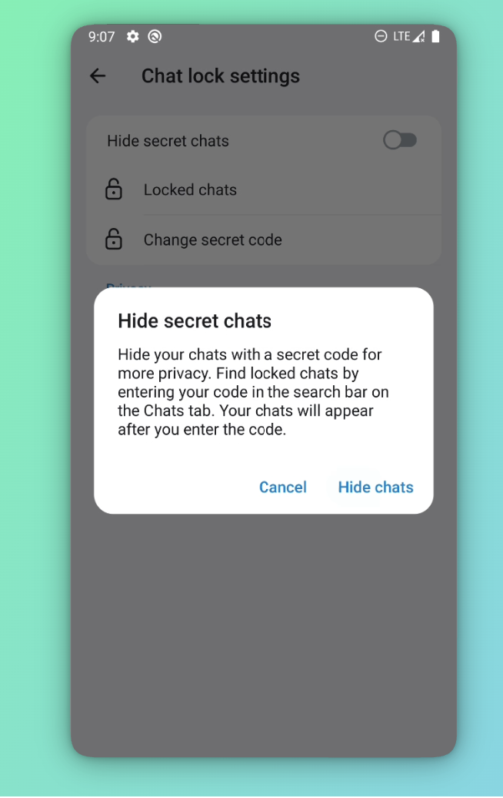

# Chats Lock


### Protect selected Telegram chats with a local lock and hide them from the chat list


<p>
  <a href="docs/videos/demo.mp4">
    
  </a>
</p>

## Platform

Android

## Overview

Chat Lock adds a per-account privacy layer for selected chats in the Telegram Android client. A locked chat can be opened with biometric authentication or a private 4-digit secret code. The lock state is local to the device and does not change the chat or message data stored on Telegram servers.

When **Hide secret chats** is enabled, locked chats are removed from the regular Chats list and ordinary search results. They can be revealed by entering the secret code in the Chats search field.

## User flow

1. Open a chat and choose **Lock chat**, or select multiple chats from the Chats list and use the lock action.
2. Confirm the privacy warning. If a secret code has not been configured, create and confirm a 4-digit code first.
3. Open a locked chat with biometrics or the secret code.
4. Manage locked chats from **Settings → Privacy and Security → Chat Lock**:
   - view the list of locked chats;
   - unlock a chat;
   - turn **Hide secret chats** on or off;
   - set or change the secret code.
5. If hidden chats are enabled, enter the secret code in Chats search to show the locked results temporarily.

## Demo


<p align="center">
  
  
  
</p>

## Security and behavior

- Biometric authentication is used when it is available; the secret code remains a fallback.
- Failed secret-code attempts use a short increasing retry delay, capped at 30 seconds.
- Locked chats remain visible with a lock indicator when hiding is disabled.
- Lock state, secret-code hash, and retry state are stored in local account preferences.
- This feature controls access in the Android UI. It is not end-to-end encryption and does not encrypt Telegram's local database or server data.

## How to apply

The patch is based on the official [DrKLO/Telegram](https://github.com/DrKLO/Telegram) client.

Clone the base revision:

```bash
git clone --recursive --shallow-submodules https://github.com/DrKLO/Telegram.git Telegram
cd Telegram
git checkout --detach 3de37c8cfb039452be7398909461da6288babf15
git submodule update --init --recursive
```

Apply the patch from this repository:

```bash
git apply --check private-chat-lock.patch
git apply private-chat-lock.patch
git diff --stat
```

The patch contains the Chat Lock changes for the Android client, including the lock manager, settings and code-entry screens, chat-list and search integration, lock indicators, and localized warning strings.
