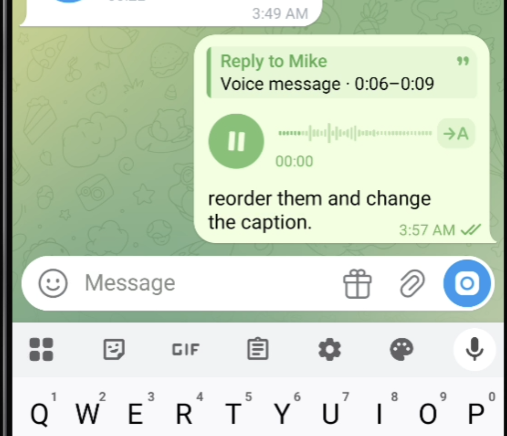
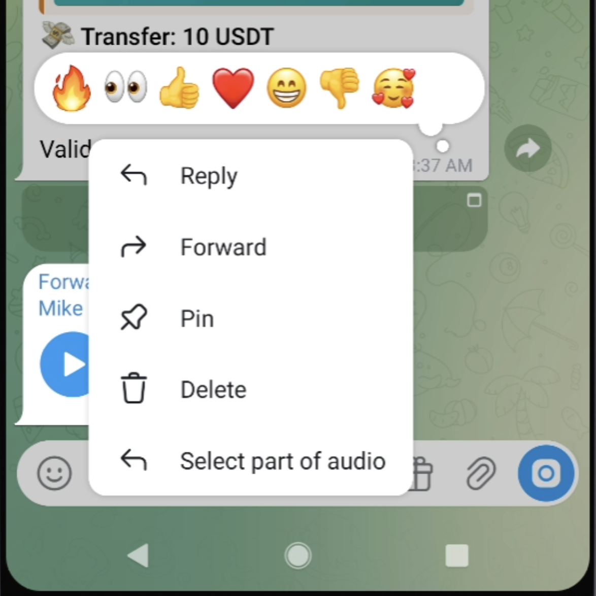
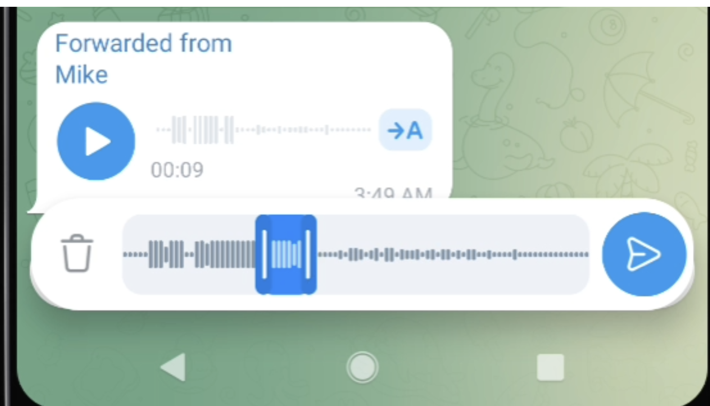
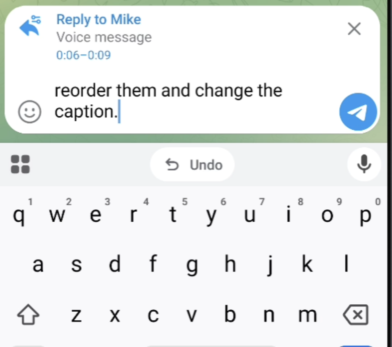

# Audio Quote - 
### Share just the part of a long voice message that matters

Android Audio Quotes — Select and share only the relevant part of a long voice message instead of sending the entire recording.

## Platform - Android


[demo.MOV](videos/demo.mp4)



## Flow: Voice Range Select
1. The user long-presses a voice message or its waveform.


2. Range selection mode opens. A highlighted segment appears around the touch position with start and end handles.


3. The user can:
    - drag the left and right handles to resize the range;
    - drag inside the selection to move the entire range;
    - preview the selected fragment.
   
4. After selecting the range, the user taps **Reply**.


5. The selected range is stored in the reply as a reference to the original voice message with `start` and `end` positions.
6. The recipient sees a compact preview of the selected audio range in the reply header: the sender’s name, quote icon, and waveform fragment.
7. Tapping the preview opens the original voice message and starts playback from the beginning of the selected range.
8. The selected fragment is not copied or sent as a separate audio file. Only the range boundaries are transmitted, and playback uses the original voice message.


# How to apply

Based on official drklo/telegram client
```
git clone --recursive --shallow-submodules https://github.com/DrKLO/Telegram.git Telegram
cd telegram
git checkout --detach 3de37c8cfb039452be7398909461da6288babf15
```

Download 
```
https://github.com/col3name/timequoute-voice-message/blob/main/timequote_changes.patch
```

Apply patches
```
git submodule update --init --recursive

git apply --check ./timequote_changes.patch
git apply ./timequote_changes.patch

git diff --stat
```
