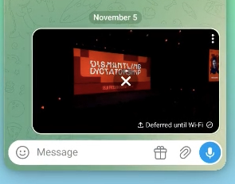

# DRKLO Android - Quick Photos Send 
## (based on drklo/telegram)

Why
Sending a photos should be as immediate as sending with one: press, slide, release.

Here you press and hold the attach button, four local demo photos fan out of it, you slide onto one and let go. The selected photos flies directly into a new outgoing message. Release anywhere else and everything folds back.


### How it works
Long-press the paperclip button to reveal four photos in an animated fan.

Slide to select one and release to send it directly into the chat. Release elsewhere to cancel.


## Platform - Android

[demo.GIF](docs/videos/demo.gif)

[demo.mp4](docs/videos/demo.mp4)




## Implementation

- `ChatActivityEnterView` detects the long press, manages the overlay, and forwards the selected photo.
- `QuickAttachmentOverlayView` renders the four-photo fan, tracking, selection, cancellation, and send transition.
- `ChatActivity` sends the selected `PhotoEntry` through the existing `sendMedia` path.
- `ChatListItemAnimator` avoids a duplicate list-entry animation while the selected photo is moving into its outgoing message cell.

# How to apply

Based on the official drklo/telegram client.

```
git clone --recursive --shallow-submodules https://github.com/DrKLO/Telegram.git Telegram
cd Telegram
git checkout --detach 3de37c8cfb039452be7398909461da6288babf15
```

Apply the patch:

```
git clone -b feature/quick-send-photos --single-branch https://github.com/col3name/timequoute-voice-message.git
git submodule update --init --recursive

git apply --check quick-attachment.patch
git apply quick-attachment.patch

git diff --stat
```
