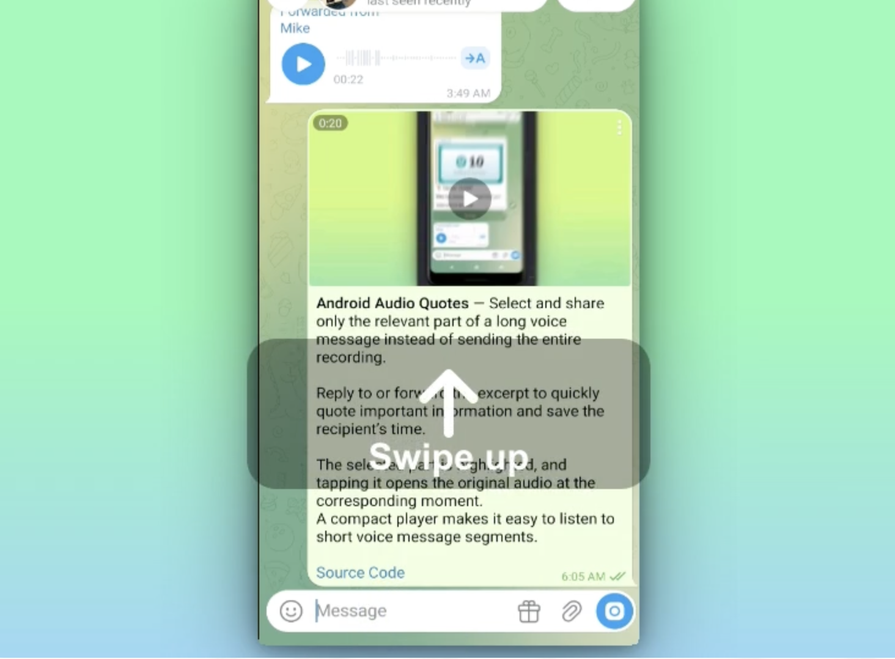

# Quick Edit Last Message

- Long-press the empty input field and swipe up to open editing for the latest editable outgoing message.
- Works in personal chats and Saved Messages.
- Does not trigger in groups, channels, secret chats, or while another message is being edited.

## Why

This feature reduces the number of steps needed to edit the last message from two actions to a single swipe-up gesture, making quick corrections faster and more convenient.



[after.mp4](docs/videos/after.mp4)

[before.mp4](docs/videos/before.mp4)


## Changes

- [ChatActivityEnterView.java (line 5411)](TMessagesProj/src/main/java/org/telegram/ui/Components/ChatActivityEnterView.java:5411)
- [ChatActivity.java (line 2108)](TMessagesProj/src/main/java/org/telegram/ui/ChatActivity.java:2108)

# How to apply

Based on official drklo/telegram client
```
git clone --recursive --shallow-submodules https://github.com/DrKLO/Telegram.git Telegram
cd telegram
git checkout --detach 3de37c8cfb039452be7398909461da6288babf15

git clone -b feature/quick-edit-last-message https://github.com/col3name/timequoute-voice-message patches
```

Apply patches
```

git submodule update --init --recursive

git apply --check ./patches/quick-edit-last-message.patch
git apply ./patches/quick-edit-last-message.patch

git diff --stat
```
