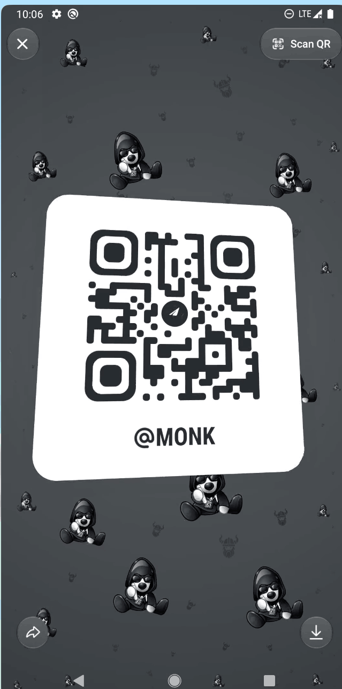
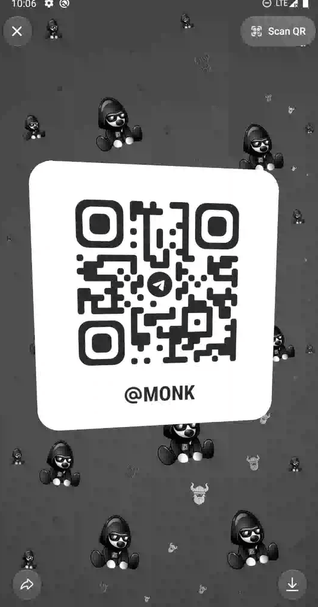

# 3D QR Code Sharing Animation

**Platform:** Android

The profile sharing screen displays the QR code on a virtual card. Touching the card tilts it toward the finger. When the touch ends, it smoothly returns to its resting position. The subtle 3D effect keeps the QR code readable and easy to scan.

Telegram concept for and **Android** (Java, Telegram-Android), built on top of the official sources.

<table>
  <tr>
    <th>Android</th>
    <th>3D QR Code</th>
    <th>Animation</th>
  </tr>
  <tr>
    <td align="center">
      <a href="docs/videos/demo.gif">Demo 15fps GIF</a>
    </td>
    <td rowspan="2" align="center">
      
    </td>
    <td rowspan="2" align="center">
      
    </td>
  </tr>
  <tr>
    <td align="center">
      <a href="docs/videos/demo.mp4">Watch Demo MP4</a>
    </td>
  </tr>
</table>


## Android

| **File** | **What** |
| --- | --- |
| `TMessagesProj/src/main/java/org/telegram/ui/QrShare/QrShareView.java` | Displays the QR card and applies a 3D tilt based on the touch position. |

## How the animation works

The card tilts toward the user's finger and smoothly returns to its resting position when the touch ends.

## Apply the patch

```bash
git clone --recursive --shallow-submodules https://github.com/DrKLO/Telegram.git Telegram
cd Telegram
git checkout --detach 3de37c8cfb039452be7398909461da6288babf15
git submodule update --init --recursive

git apply --check 3d-qrcode-animation.patch
git apply 3d-qrcode-animation.patch


```

## Notes

The 3D tilt currently responds to touch input.

It could also be linked to the device’s motion sensors, allowing the card to tilt as the user moves the phone.
